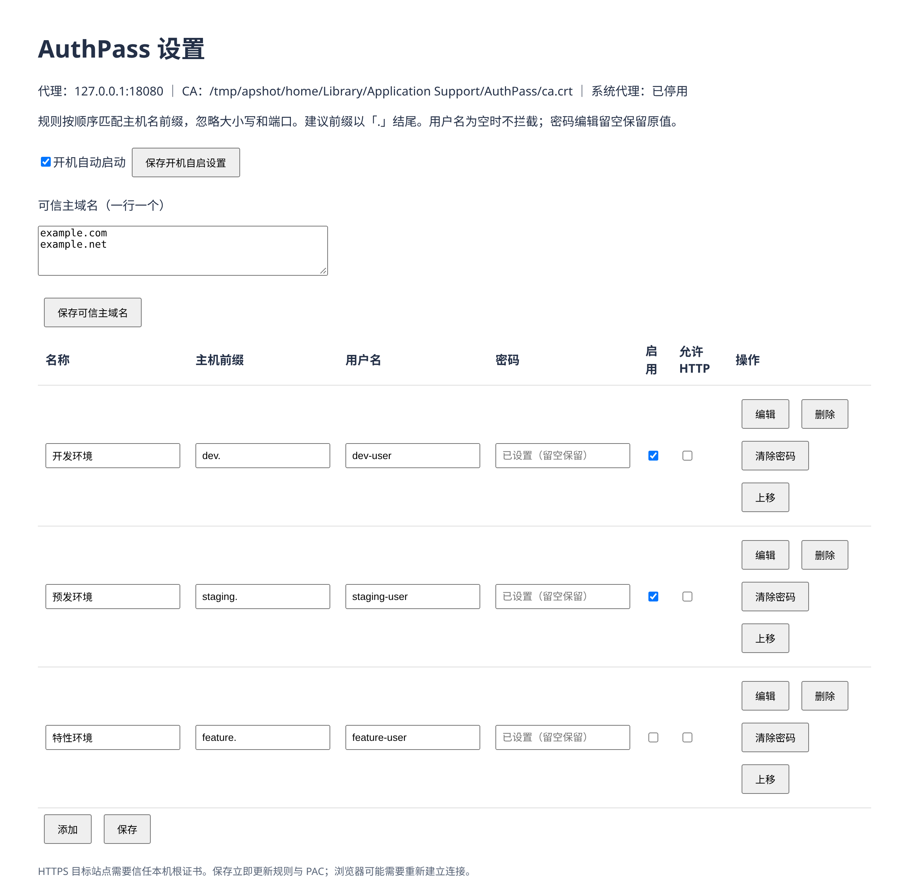

# AuthPass

一个 macOS 菜单栏小工具：按域名前缀自动为网站填写 HTTP Basic Auth，不用每次打开测试、预发这类环境都输一遍账号密码。

在系统层生效，Safari、Chrome、Edge、Firefox 等浏览器都能用，无痕窗口也有效。

## 功能

- 在可信主域名及其子域名内按主机名前缀匹配规则，例如 `dev.` 匹配 `dev.example.com`，默认仅为 HTTPS 注入凭据
- 每条规则有自己的用户名和密码，可以随时添加、编辑、删除、调整顺序、启用或停用
- 不内置任何账号密码，全部由用户自己填写；密码存在 macOS 钥匙串里
- 开机自动启动（默认开启，可关闭）
- 只拦截匹配规则的域名，其他网站的流量不会被解密或改动

## 安装

1. 到 [Releases](https://github.com/gluttony-club/AuthPass/releases/latest) 下载 `AuthPass.dmg`。
2. 双击打开，把 AuthPass 拖进「应用程序」。
3. 从「应用程序」里打开 AuthPass。

系统要求 macOS 13 及以上，Apple 芯片和 Intel 都支持。

应用没有做苹果开发者签名，首次打开会被系统拦截。处理方法任选一种：

- 打开「系统设置 → 隐私与安全性」，拉到底部，点 AuthPass 旁的「仍要打开」。
- 或在终端执行：

  ```sh
  xattr -dr com.apple.quarantine "/Applications/AuthPass.app"
  ```

首次启动 AuthPass 时会生成本机根证书；第一次启用时将它加入钥匙串信任，系统会要求输入密码或使用 Touch ID。

## 使用

1. 点击菜单栏的 AuthPass 图标，选择「设置…」。
2. 先在「可信主域名（一行一个）」文本框填写你控制或信任的主域名（如 `example.com`），点「保存可信主域名」。列表为空时所有规则都不生效，设置页会显示警告。
3. 点「添加」，填写名称、主机前缀（如 `dev.`、`staging.`）、用户名和密码。默认只用于 HTTPS；确需用于明文 HTTP 时，勾选该规则的「允许 HTTP」。
4. 点「保存」，规则立即更新，刷新网页即可；浏览器可能需要重新建立连接。



规则说明：

- 主机必须同时以规则前缀开头，并且是可信主域名本身或其子域名；匹配忽略大小写和端口，按列表顺序取第一条启用且匹配的规则。
- 域名按点分隔的边界匹配：信任 `example.com` 时，`dev.example.com` 在范围内；`dev.evil.com`、`dev.example.com.evil.com`、`devexample.com` 都不在范围内。只按前缀匹配会让任意网页通过嵌入 `https://dev.evil.com/x.png` 等资源，诱使浏览器经代理把你的凭据发送给攻击者。
- 可信主域名（`trusted_domains`）只允许小写字母、数字、点和连字符，必须含点，不能用通配符、连续点或以点开头、结尾；输入会自动转为小写并去除首尾空白。不能填 IP 地址，也不能以纯数字结尾（如 `10.0.0.1`、`0.1`）。
- 含非 ASCII 字符的主机名永远不会注入凭据。中文等国际化域名请按 punycode 形式（`xn--` 开头）填写，浏览器实际访问的也是这种形式。
- 前缀会自动转为小写并去除首尾空白，只能包含 `a-z 0-9 . -`，建议以 `.` 结尾。它只匹配开头，不是通配符：`dev.` 能匹配 `dev.example.com`，不能匹配 `mydev.example.com`。
- 已启用但用户名为空的规则表示「不拦截」，并停止继续匹配；后续前缀重叠的规则会跳过这些主机。
- 默认不会为明文 `http://` 请求添加 `Authorization`；只有该规则开启「允许 HTTP」（`allow_http: true`）才会注入。HTTP 会明文传输密码，请谨慎开启。
- 编辑时密码留空表示保持原密码，点「清除密码」才会删除。

菜单里还可以启用/停用、打开配置目录、安装/信任根证书、切换开机自动启动、退出。停用或退出时会恢复原来的系统代理设置。

### 配置文件示例

规则保存在 `~/Library/Application Support/AuthPass/config.json`，一般在设置页改就行，不用手动编辑。密码不在这个文件里，只存在钥匙串中。

```json
{
  "listen": "127.0.0.1:18080",
  "launch_at_login": true,
  "trusted_domains": ["example.com"],
  "rules": [
    {"id": "dev", "name": "开发环境", "host_prefix": "dev.", "username": "dev-user", "allow_http": false, "enabled": true},
    {"id": "staging", "name": "预发环境", "host_prefix": "staging.", "username": "staging-user", "allow_http": false, "enabled": true},
    {"id": "feature", "name": "特性环境", "host_prefix": "feature.", "username": "feature-user", "allow_http": false, "enabled": false}
  ]
}
```

按这份配置，`https://dev.example.com` 使用 dev-user，`https://staging.example.com` 使用 staging-user（密码需在设置页保存）；特性环境规则已停用。只有 `example.com` 及其子域名在可信范围内，`dev.example.net` 不匹配；三条规则都不向明文 HTTP 注入凭据。

### 高级配置（仅限开发/测试）

以下选项只能手动编辑 `config.json`，仅用于开发和测试，修改后重启 AuthPass：

- `upstream_ca_file`：额外信任的上游 TLS CA 证书 PEM 文件路径，例如自签名测试环境的 CA。
- `insecure_skip_verify_upstream`：设为 `true` 会跳过上游 TLS 证书验证，有被中间人攻击的危险。
- `host_overrides`：主机名到 IP 的映射，用于测试，例如 `{"dev.example.com": "127.0.0.1"}`。

### 升级说明

**钥匙串访问提示**：AuthPass 只做了 ad-hoc 签名（没有苹果开发者签名），每个版本的签名都不一样，所以**每次升级后**首次启动时，macOS 都可能再次询问是否允许 AuthPass 访问钥匙串中已保存的密码，请选择「始终允许」。如果点了「拒绝」，AuthPass 不会退出：对应规则暂按无密码处理，菜单和设置页会显示提示，钥匙串里的密码项也不会被删除；退出后重新打开 AuthPass 并选择「始终允许」，或在设置页重新输入该规则的密码并保存即可恢复。

**从 1.1.0 升级到 1.1.1**：规则、可信主域名和密码都会保留，一般无需改动。如果可信主域名里填过 IP 地址或以纯数字结尾的条目，1.1.1 会拒绝这份配置，并在菜单里显示错误；请点「打开配置目录」，在 `config.json` 的 `trusted_domains` 中删除这些条目，然后点「启用」。

**从 1.0.0 升级**：原有规则和钥匙串密码会保留，但必须先填写「可信主域名」并保存，规则才会生效；明文 HTTP 站点还需逐条开启「允许 HTTP」。

### Firefox

Firefox 默认不信任系统证书。在 `about:config` 中把 `security.enterprise_roots.enabled` 设为 `true`，并确认网络设置为「使用系统代理设置」。

## 工作原理

AuthPass 在本机 `127.0.0.1:18080` 运行一个代理，并设置系统自动代理（PAC），只把匹配规则的域名交给它：

- HTTP 请求：仅在匹配规则开启 `allow_http` 时添加 `Authorization`；否则原样转发，不注入凭据。
- HTTPS 请求：用本机生成的根证书在本地解密、加头后再转发到目标站点。
- 其他域名：PAC 直接返回 DIRECT，不经过代理。

## 安全说明

- 安装包里没有任何凭据；密码只保存在本机钥匙串中。
- 根证书和私钥每台机器单独生成，只有同时匹配可信域名和规则前缀的主机会被解密。
- 代理只监听本机回环地址，设置页使用每次启动随机生成的 token 保护。

## 风险说明

- 本机根 CA 能为**任意域名**签发证书。私钥保存在 `~/Library/Application Support/AuthPass/ca.key`，权限为 `0600`；切勿分享或备份到不可信的位置。卸载时须同时删除私钥和钥匙串中的受信任证书。
- 启用 AuthPass 会在启用期间替换当前系统自动代理（PAC）设置，例如 Clash、Surge 或公司 PAC；停用或退出时恢复原设置，强制退出后会在下次启动时恢复。
- 只添加你控制或信任的可信主域名，避免把凭据发送给不可信的站点。
- 漏洞报告方式见 [SECURITY.md](SECURITY.md)，请通过私密渠道报告。

## 已知限制

- 不支持 WebSocket、HTTP/2 解密和客户端证书认证。
- 自行忽略系统代理的应用不受影响；VPN 或其他代理工具可能与本工具冲突。
- 强制退出时无法立刻恢复系统代理，下次启动会自动恢复。

## 卸载

1. 在菜单中选择「停用」，然后退出。
2. 删除 `/Applications/AuthPass.app`。
3. 删除 `~/Library/Application Support/AuthPass` 和 `~/Library/LaunchAgents/club.gluttony.authpass.plist`。
4. 在「钥匙串访问」中删除证书 `AuthPass Local CA`，以及服务名为 `club.gluttony.authpass` 的密码项。

## 从源码构建

需要 Go 1.24+ 和 Xcode Command Line Tools：

```sh
xcode-select --install
./build-mac.sh          # 生成 dist/AuthPass.app（arm64 + x86_64 通用，任一架构失败即报错）
./build-mac.sh --dmg    # 同时生成 dist/AuthPass.dmg
```

运行测试：

```sh
go test ./...
./test/e2e.sh           # 端到端测试，可在 Linux 上运行
```

## 许可证

[MIT](LICENSE)
